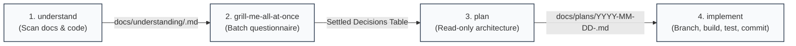

# LinenGrass Agent Skills

A production-grade, four-stage AI agent engineering workflow suite compliant with the [Agent Skills specification](https://agentskills.io/) and verified with [NVIDIA SkillEvaluator](https://github.com/NVIDIA/SkillEvaluator) (Grade A across all skills).

---

## The Workflow Pipeline

The LinenGrass skill suite enforces an end-to-end SDLC discipline. It eliminates shallow code patches, hallucinated interfaces, and test tampering by dividing software development into four strict, gated phases:



---

## Skills Overview

| Skill | Canonical Manifest | Primary Responsibility | Input Gate | Output Artifact |
| :--- | :--- | :--- | :--- | :--- |
| **`understand`** | [`skills/understand/SKILL.md`](skills/understand/SKILL.md) | Deeply inspects codebase documentation, interfaces, and implicit business rules before asking the developer anything. | Target module or area path | `docs/understanding/<area>.md` |
| **`grill-me-all-at-once`** | [`skills/grill-me-all-at-once/SKILL.md`](skills/grill-me-all-at-once/SKILL.md) | Maps the decision tree and presents a complete upfront questionnaire with recommendations and dependencies in a single pass. | Problem statement or draft approach | Settled decisions table |
| **`plan`** | [`skills/plan/SKILL.md`](skills/plan/SKILL.md) | Produces an exact file-level blueprint without modifying source code. Read-only gatekeeper. | Understanding brief + settled grill decisions | `docs/plans/YYYY-MM-DD-<slug>.md` |
| **`implement`** | [`skills/implement/SKILL.md`](skills/implement/SKILL.md) | Builds the entire plan on a dedicated branch, verifies compilation, tests once at the end, and enforces strict anti-cheating rules. | Plan document + clean git tree + green baseline | Working branch & verified commit |

---

## NVIDIA SkillEvaluator Verification

Every skill in this repository is audited against static analysis rules, schema conformance, harness compatibility, and behavioral safety:

| Skill | Tier 1 Schema | Harness Compatibility (6/6) | Quality Score | Grade |
| :--- | :---: | :---: | :---: | :---: |
| **`grill-me-all-at-once`** | ✅ PASS (8/8) | ✅ Claude Code, Codex, Copilot CLI, Hermes, OpenClaw, OpenCode | **93.8 / 100** | **Grade A** |
| **`plan`** | ✅ PASS (8/8) | ✅ Claude Code, Codex, Copilot CLI, Hermes, OpenClaw, OpenCode | **92.5 / 100** | **Grade A** |
| **`understand`** | ✅ PASS (8/8) | ✅ Claude Code, Codex, Copilot CLI, Hermes, OpenClaw, OpenCode | **91.2 / 100** | **Grade A** |
| **`implement`** | ✅ PASS (8/8) | ✅ Claude Code, Codex, Copilot CLI, Hermes, OpenClaw, OpenCode | **95.0 / 100** | **Grade A** |

---

## How to Install and Use

### In Claude Code / Codex / Hermes / OpenCode
Clone or add the skills to your project or global skill path:

```bash
# Global installation (available to all agent sessions)
mkdir -p ~/.agents/skills
cp -r skills/* ~/.agents/skills/

# Or link directly into your repository
git clone https://github.com/akshith2k4/LinenGrass-Skills.git
ln -s "$(pwd)/LinenGrass-Skills/skills" .agents/skills
```

### Running Checks Locally
To run quality and schema validation using NVIDIA SkillEvaluator:

```bash
# Install / run with uv
uvx skillevaluator harness-check skills/implement
uvx skillevaluator quality-check skills/implement
uvx skillevaluator tier1 skills/implement --no-llm
```

---

## License

Apache-2.0
