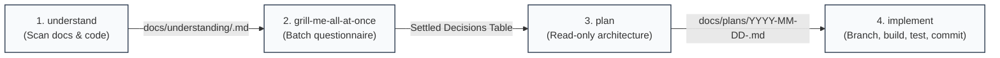

<p align="center">
  
</p>

<h1 align="center">LinenGrass Agent Skills</h1>

<p align="center">
  <strong>Production-grade, four-stage AI agent engineering workflow suite</strong><br>
  Compliant with the <a href="https://agentskills.io/">Agent Skills specification</a> and verified with <a href="https://github.com/NVIDIA/SkillEvaluator">NVIDIA SkillEvaluator</a> (Grade A across all skills).
</p>

<p align="center">
  <a href="#quick-installation"></a>
  <a href="#nvidia-skillevaluator-verification"></a>
  
</p>

---

## Quick Installation

To install the skills directly into your project's local folder (inside `.agents/skills/`) without prompting for 70+ external agent symlinks, run:

```bash
npx skills add akshith2k4/LinenGrass-Skills --copy -y
```

### Advanced Options

- **Add globally across all supported agents**:
  ```bash
  npx skills add akshith2k4/LinenGrass-Skills --all -g
  ```

- **Add a single specific skill**:
  ```bash
  npx skills add akshith2k4/LinenGrass-Skills --skill implement --copy -y
  ```

- **Run on-demand without installing**:
  ```bash
  npx skills use akshith2k4/LinenGrass-Skills@plan
  ```

---

## The Workflow Pipeline

The LinenGrass skill suite enforces an end-to-end SDLC discipline. It eliminates shallow code patches, hallucinated interfaces, and test tampering by dividing software development into four strict, gated phases:



Each stage is a hard gate: `understand` ends at the brief, `grill-me-all-at-once` ends at the confirmed decisions table, and `plan` ends at the plan document. No stage rolls into implementation on its own. `implement` starts only when the developer explicitly asks to execute a saved plan, and it is local-only — it will not push, open a PR, or merge unless explicitly instructed.

---

## Skills Overview

| Skill | Canonical Manifest | Primary Responsibility | Input Gate | Output Artifact |
| :--- | :--- | :--- | :--- | :--- |
| **`understand`** | [`skills/understand/SKILL.md`](skills/understand/SKILL.md) | Deeply inspects codebase documentation, interfaces, and implicit business rules before asking the developer anything. | Target module or area path | `docs/understanding/<area>.md` |
| **`grill-me-all-at-once`** | [`skills/grill-me-all-at-once/SKILL.md`](skills/grill-me-all-at-once/SKILL.md) | Maps the decision tree and presents a complete upfront questionnaire with recommendations and dependencies in a single pass. | Problem statement or draft approach | Settled decisions table |
| **`plan`** | [`skills/plan/SKILL.md`](skills/plan/SKILL.md) | Produces an exact file-level blueprint without modifying source code. Read-only gatekeeper. | Understanding brief + settled grill decisions | `docs/plans/YYYY-MM-DD-<slug>.md` |
| **`implement`** | [`skills/implement/SKILL.md`](skills/implement/SKILL.md) | Builds the entire plan on a dedicated local branch, verifies compilation, tests once at the end, and enforces strict anti-cheating rules. | Plan document + clean git tree + green baseline | Local working branch & verified commit |

---

## NVIDIA SkillEvaluator Verification

Every skill in this repository is audited against static analysis rules, schema conformance, harness compatibility, and behavioral safety:

| Skill | Tier 1 Schema | Harness Compatibility (6/6) | Quality Score | Grade |
| :--- | :---: | :---: | :---: | :---: |
| **`grill-me-all-at-once`** | ✅ PASS (8/8) | ✅ Claude Code, Codex, Copilot CLI, Hermes, OpenClaw, OpenCode | **93.8 / 100** | **Grade A** |
| **`plan`** | ✅ PASS (8/8) | ✅ Claude Code, Codex, Copilot CLI, Hermes, OpenClaw, OpenCode | **92.5 / 100** | **Grade A** |
| **`understand`** | ✅ PASS (8/8) | ✅ Claude Code, Codex, Copilot CLI, Hermes, OpenClaw, OpenCode | **91.2 / 100** | **Grade A** |
| **`implement`** | ✅ PASS (8/8) | ✅ Claude Code, Codex, Copilot CLI, Hermes, OpenClaw, OpenCode | **95.0 / 100** | **Grade A** |
| **`module-migration`** | ✅ PASS (10/10) | ✅ Claude Code, Codex, Copilot CLI, Hermes, OpenClaw, OpenCode | **100.0 / 100** | **Grade A** |

---

## Running Validation Locally

To run quality and schema validation using NVIDIA SkillEvaluator:

```bash
# Validate harness loading
uvx skillevaluator harness-check skills/implement

# Run quality scoring across Correctness, Reliability, and Efficiency
uvx skillevaluator quality-check skills/implement

# Run Tier 1 static checks
uvx skillevaluator tier1 skills/implement --no-llm
```

---

## License

Apache-2.0
